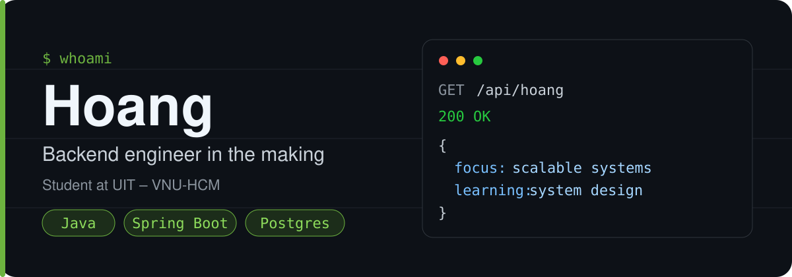

  

  
  
  
  
  
  
  
  

---

## 🚀 Featured projects

| Project | What it is | Stack |
|---|---|---|
| [**DevOrbit**](https://github.com/huyhoang171106/DevOrbit) | Course-advisory portal for UIT students: course directory, repo recommendations, real-time chat and an AI tutor | Java 21 · Spring Boot · PostgreSQL · JWT · WebSocket · React |
| [**VietFi Advisor**](https://github.com/huyhoang171106/vietfi-advisor-final) | AI financial advisor for Vietnamese Gen Z (WDA 2026 competition project) | Next.js · TypeScript · Supabase · Gemini |
| [**LOOPHOLE**](https://github.com/huyhoang171106/boss-vs-hero) | Asymmetric strategy game: you design the arena, an adaptive AI hero tries to beat it | TypeScript |
| [**Open-Meteo Weather Pipeline**](https://github.com/huyhoang171106/open-meteo-weather-pipeline-demo) | ETL pipeline: hourly weather data → batch aggregation → CSV and Excel dashboard | Python · Node.js |
| [**UIT Knowledge**](https://github.com/huyhoang171106/uitknowledge) | Course and video learning platform for the UIT community | JavaScript · Supabase |

## 🎯 Focus

- 🛠 **Working on:** backend development — scalable, high-performance systems
- 🌱 **Learning:** software engineering, Java, Spring Boot, system design, cloud architecture
- 🤝 **Open to:** open-source collaboration and backend projects
- 💬 **Ask me about:** Java, Spring Boot, database optimization, clean code

## 📊 GitHub stats

  
  

## 📫 Contact

